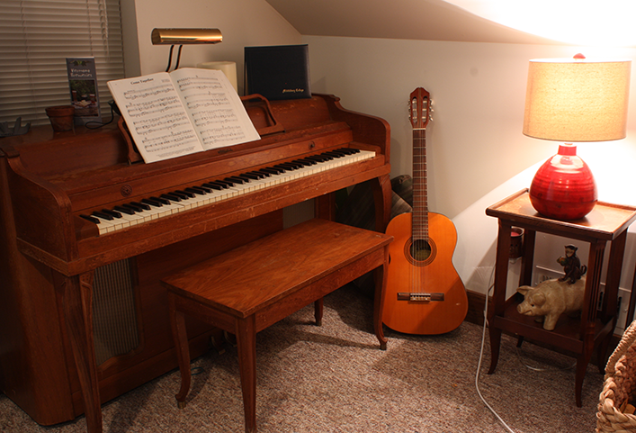

# depth_anything_cpp

## Acerca de Este Proyecto

Este proyecto es una implementación en C++ del algoritmo `DepthAnything`, incluyendo tres plataformas de hardware (motores de inferencia): `TensorRT`, `RKNN` y `OnnxRuntime`.

## Características

1. Soporta múltiples motores de inferencia: `TensorRT`, `RKNN`, `OnnxRuntime`
2. Soporta inferencia asíncrona y multi-núcleo, con un alto rendimiento, especialmente en la plataforma `RK3588`

## Demostración

|  |  |
|:----------------------------------------:|:----:|
| **imagen de entrada**  | **profundidad en color** |

|  nvidia-3080-laptop   |   qps   |  cpu   |
|:---------:|:---------:|:----------------:|
|  depth_anything_v2(fp16)   |   **197**   |  120%   |
|  depth_anything_v2(fp16) - ***async***  |   **208**   |  180%   |


|  jetson-orin-nx-16GB   |   qps   |  cpu   |
|:---------:|:---------:|:----------------:|
|  depth_anything_v2(fp16)   |   **39**   |  27%   |
|  depth_anything_v2(fp16) - ***async***  |   **41**   |  34%   |


|  orangepi-5-plus-16GB   |   qps   |  cpu   |
|:---------:|:---------:|:----------------:|
|  depth_anything_v2(fp16)   |   **1.2**   |  14%   |
|  depth_anything_v2(fp16) - ***async***  |   **3.2**   |  33%   |

|  intel-i7-11800H   |   qps   |  cpu   |
|:---------:|:---------:|:----------------:|
|  depth_anything_v2(fp32)   |   **3.9**   |  800%   |

## Uso

### Descargar Proyecto

Clonar el proyecto git
```bash
git clone git@github.com:zz990099/depth_anything_cpp.git
cd depth_anything_cpp
git submodule init && git submodule update
```

### Construir Entorno

Usar docker para construir el entorno de trabajo
```bash
cd depth_anything_cpp
bash easy_deploy_tool/docker/build_docker.sh --platform=jetson_trt8_u2004 # or jetson_trt8_u2204, nvidia_gpu, rk3588
bash easy_deploy_tool/docker/into_docker.sh
```

### Compilar Código

En el contenedor docker, compilar el proyecto. Usar `-DENABLE_*` para habilitar un motor de inferencia específico, las opciones disponibles son: `-DENABLE_TENSORRT=ON`, `-DENABLE_RKNN=ON`, `-DENABLE_ORT=ON`, se pueden combinar. 
```bash
cd /workspace
mkdir build && cd build
cmake .. -DBUILD_TESTING=ON -DENABLE_TENSORRT=ON
make -j
```

### Convertir Modelo

Descargar el modelo desde [enlace](https://drive.google.com/drive/folders/1Bq0OS5VF7xYcu3oBl_rsGzjJ7u2IfHt2?usp=drive_link), colocarlo en la carpeta `/workspace/models`. En el contenedor docker, ejecutar el script de conversión de modelos:
```bash
cd /workspace
bash tools/cvt_onnx2trt.sh
```

### Ejecutar Casos de Prueba

Ejecutar casos de prueba, referirse a la documentación del código para más detalles.
```bash
cd /workspace/build
./bin/simple_tests --gtest_filter=*correctness
# Limitar salida GLOG
GLOG_minloglevel=1 ./bin/simple_tests --gtest_filter=*speed
```

## Referencias

- [DepthAnythingV1](https://github.com/LiheYoung/Depth-Anything)
- [DepthAnythingV2](https://github.com/DepthAnything/Depth-Anything-V2)
- [EasyDeployTool](https://github.com/zz990099/EasyDeployTool)
